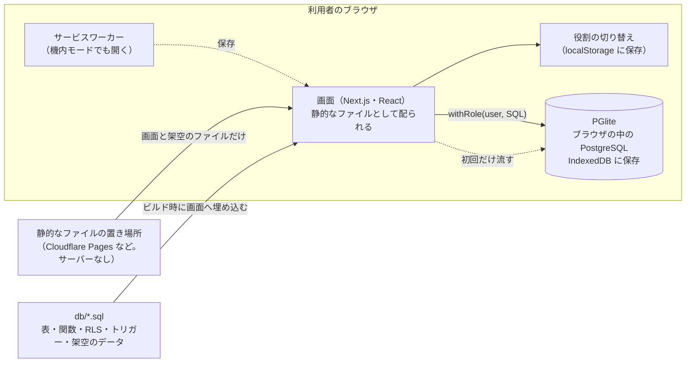
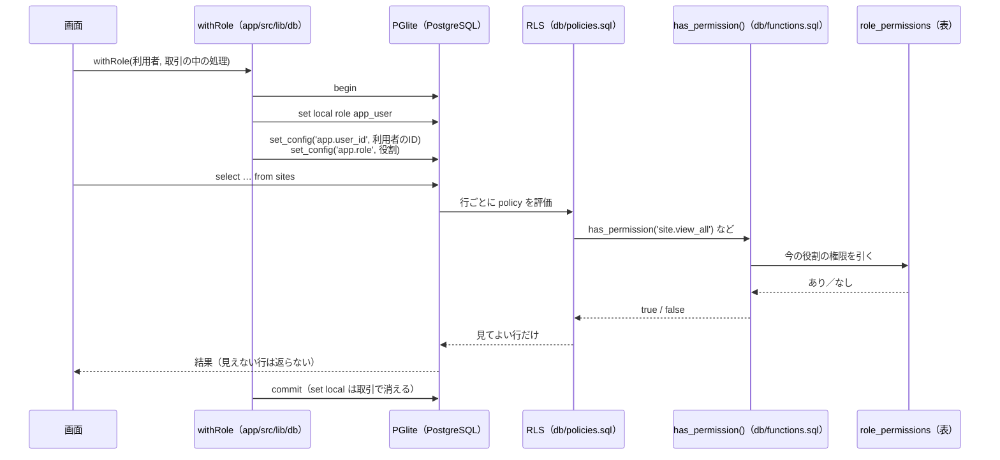
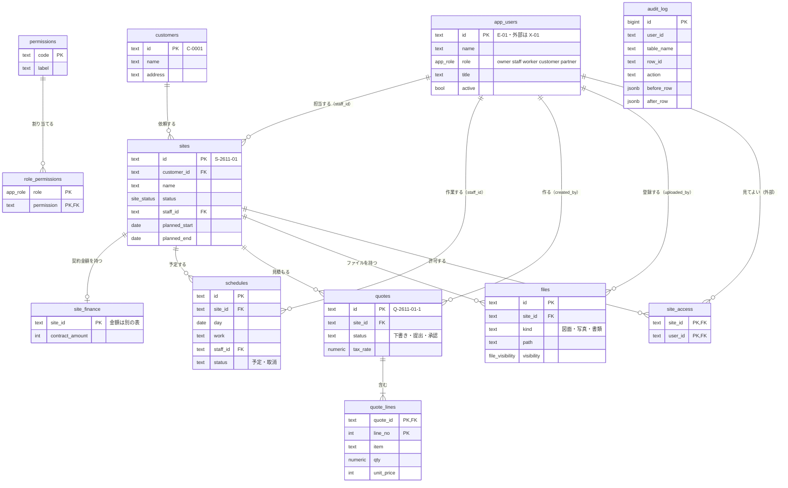
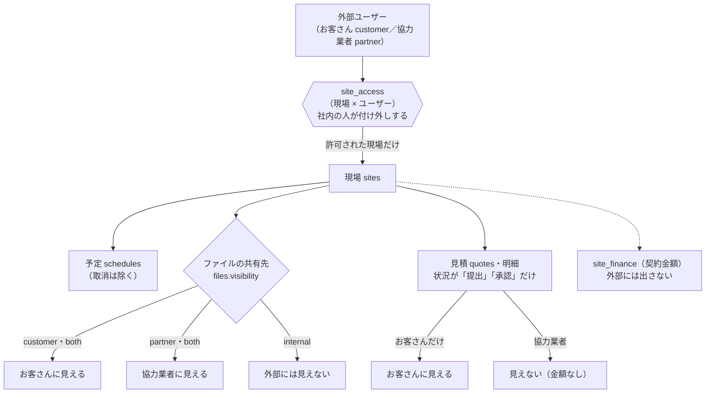

# 設計の図（Site Manager）

全体のしくみ、権限の判定の流れ、表の関係、外部ユーザーの見える範囲を、図で示します。図は [Mermaid](https://mermaid.js.org/) で書いてあり、GitHub 上ではそのまま図として表示されます。

元のコードは次のとおりです。

- 表：[db/schema.sql](../db/schema.sql)
- 判定の関数：[db/functions.sql](../db/functions.sql)
- 行ごとの制御（RLS）：[db/policies.sql](../db/policies.sql)
- 履歴のトリガー：[db/triggers.sql](../db/triggers.sql)
- ブラウザの中のデータベース：[app/src/lib/db/index.ts](../app/src/lib/db/index.ts)

## 1. 全体

画面は、静的なファイルとして配られます。データは配らず、ブラウザの中の PGlite に入ります。初めて開いたときに、ビルドで埋め込んだ SQL（表・権限の判定・RLS・架空のデータ）を流します。流し終わると `_demo_ready` の印を付け、途中で止まったときは次に開いたとき作り直します。「最初に戻す」は、同じ SQL を流し直します。

## 2. 権限の判定の流れ

画面は、必ず `withRole` の中で SQL を実行します。`app_user` という権限の弱い役割に切り替えるので、行ごとの制御（RLS）が必ず効きます。見える範囲は DB が決めるので、画面側で出し分けを間違えても、見えてはいけない行は返りません。

利用者と役割は、取引の中のセッション設定（`app.user_id`・`app.role`）で渡します。本番で Supabase にするときは、この取り出し（`current_user_id()`・`current_app_role()`）だけを認証に置き換えます。

## 3. 表の関係

見積の金額は、明細の「数量 × 単価」の合計に対して、消費税を1回（10%・切り捨て）かけて出します。契約金額は、職人に見せないために `site_finance` という別の表に分けています（列ごとの RLS は書けないためです）。

`audit_log`（変更の履歴）は、ほかの表と線で結んでいません。現場・見積・明細・ファイル・許可・予定の変更を、トリガーが書きます。画面から書き換えることはできません。

## 4. 外部ユーザー（お客さん・協力業者）の見える範囲

外部ユーザーが見られるのは、`site_access` で許可された現場だけです。そのうえで、ファイルは共有先（`internal`・`customer`・`partner`・`both`）で絞られ、見積はお客さんだけ、提出・承認の状況のものだけが見えます。協力業者には、金額も見積も出ません。

社内の人が許可を外す、またはファイルの共有先を `internal` に戻すと、次の読み込みから外部の画面に出なくなります。外部ユーザーが社内の画面（`/sites/` など）を開いたときは、専用ページ（`/portal/`）に戻されます。
